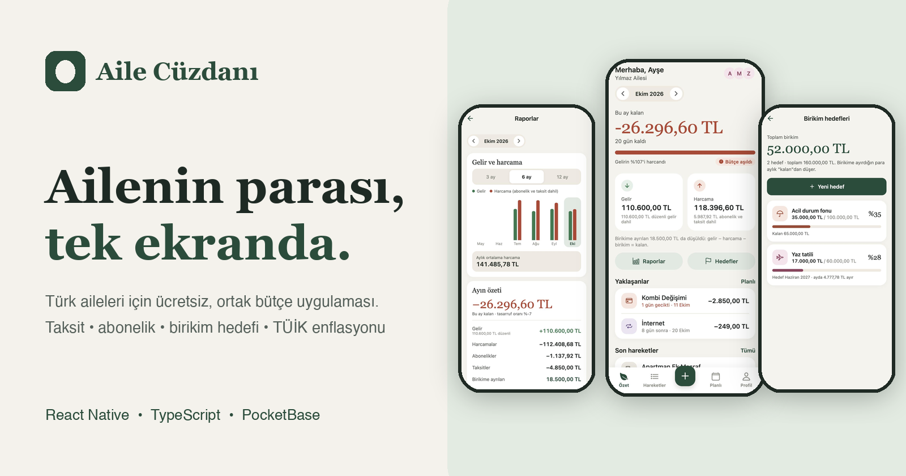
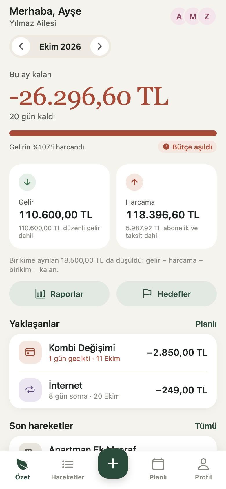
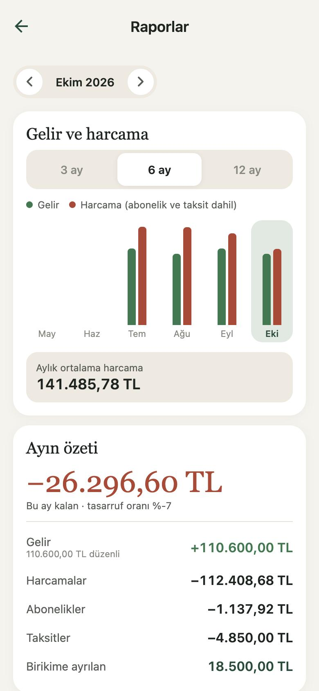
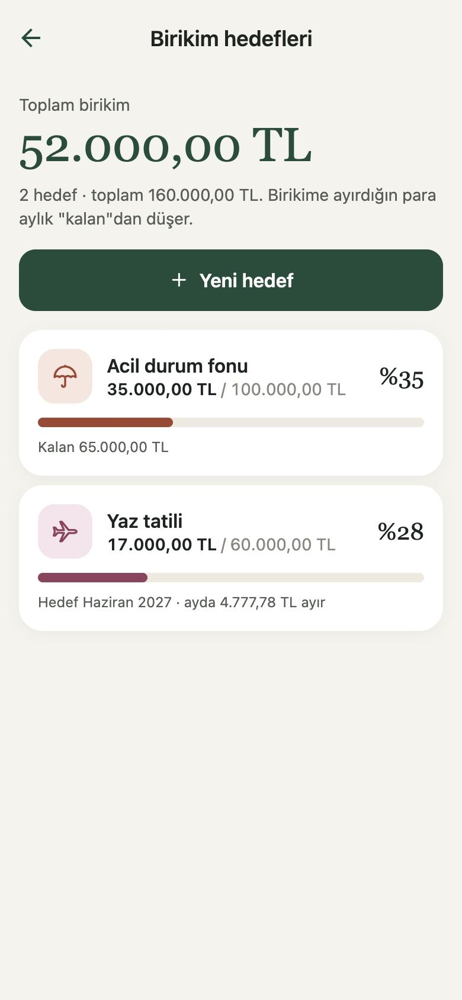
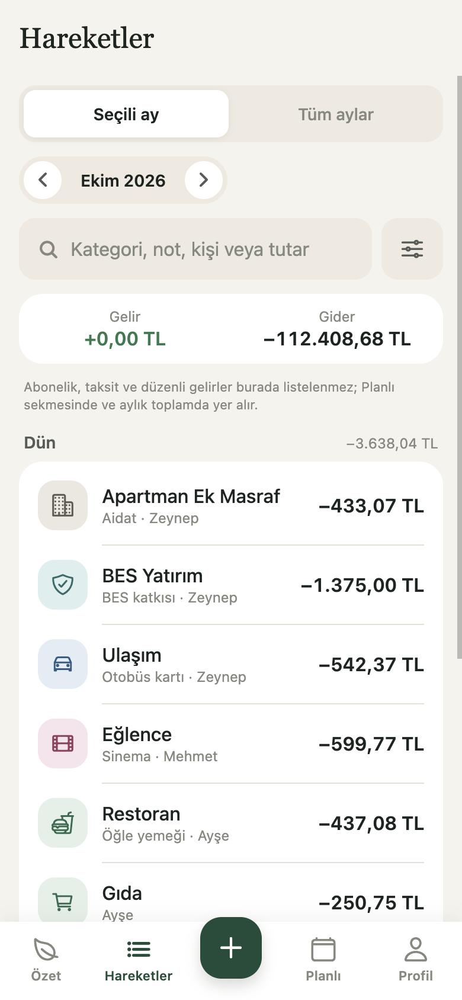
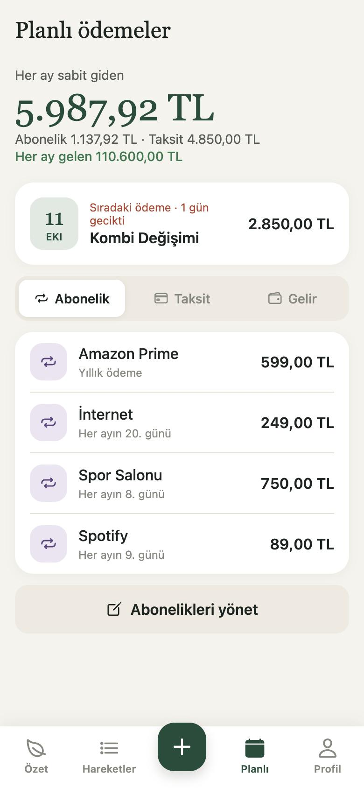

  

  <b>🇹🇷 Türkçe</b> · <a href="#-english">🇬🇧 English</a>

# Aile Cüzdanı

Türk aileleri için **ücretsiz, ortak bütçe** uygulaması. Maaşını bir kez ekle; gelir, gider,
taksit, abonelik ve birikim hedefleri tek ekranda, ailenin tüm üyeleriyle birlikte görünsün.

> **Durum:** Geliştirme aşamasında. Henüz App Store / Google Play'de yayında değil ve
> canlı bir sunucusu yok; şu an yerel ortamda çalışıyor. Kaynak kod özel (private) tutuluyor,
> bu sayfa uygulamayı tanıtmak içindir. Ekran görüntülerindeki aile ve rakamlar **demo verisidir**.

## Ekran görüntüleri

<table>
  <tr>
    <td align="center"> <b>Özet</b> Ayın kalan parası, gelir ve harcama</td>
    <td align="center"> <b>Raporlar</b> Aylık trend ve ayın özeti</td>
    <td align="center"> <b>Birikim hedefleri</b> Ortak hedefler, aylık ayırma önerisi</td>
  </tr>
  <tr>
    <td align="center"> <b>Hareketler</b> Güne göre gruplu, aranabilir liste</td>
    <td align="center"> <b>Planlı ödemeler</b> Abonelik, taksit ve düzenli gelir</td>
    <td></td>
  </tr>
</table>

## Neler var?

- **Ortak aile bütçesi:** davet koduyla 5 kişiye kadar; kim ne harcadı görünür
- **Düzenli gelir:** maaşı bir kez gir, her ay kendiliğinden eklensin
- **Taksit takibi:** ilerleme takvimden hesaplanır, Türkiye'deki taksit alışkanlığına göre
- **Abonelik ve planlı ödemeler:** yaklaşan ödemeler ve gecikme uyarısı
- **Birikim hedefleri:** ortak hedefler ve hedef tarihe göre aylık ayırma önerisi
- **Kategori limitleri:** %80 ve %100'de bildirim
- **Raporlar:** 3 / 6 / 12 aylık gelir-harcama trendi
- **TÜİK enflasyonu:** resmî veriden, kişisel enflasyon hesabıyla
- **Uygulama kilidi, CSV dışa aktarma, hesap silme**
- Türkçe arayüz, açık ve koyu tema

## Nasıl yapıldı?

| | |
|---|---|
| **İstemci** | React Native (Expo), TypeScript (strict) |
| **Sunucu** | PocketBase; erişim kuralları ve özel rotalar sunucuda uygulanır |
| **Test** | Vitest ile 176 birim testi, ayrıca gerçek bir PocketBase'e karşı HTTP seviyesinde yüzlerce entegrasyon kontrolü |
| **Bildirim** | Zamanlayıcı betik (Python), Expo push |

---

## 🇬🇧 English

A **free, shared household budget app for Turkish families.** Add your salary once and see
income, expenses, instalments, subscriptions and savings goals on one screen, together with
your family.

> **Status:** In development. It is not on the App Store or Google Play and has no hosted
> backend yet; it currently runs locally. The source code is private and this page is a
> showcase. The family and numbers in the screenshots are **demo data**.

**Highlights:** shared family budget (up to 5 members, invite code) · recurring income ·
instalment tracking built around how Turkish households actually pay · subscriptions and
planned payments · shared savings goals · category limits with alerts · 3/6/12-month
reports · official TÜİK inflation data with a personal inflation estimate · app lock ·
CSV export · account deletion · Turkish UI with light and dark themes.

**Stack:** React Native (Expo) · TypeScript (strict) · PocketBase · Python notification
scheduler · 176 Vitest unit tests plus HTTP-level integration checks against a real
PocketBase.

