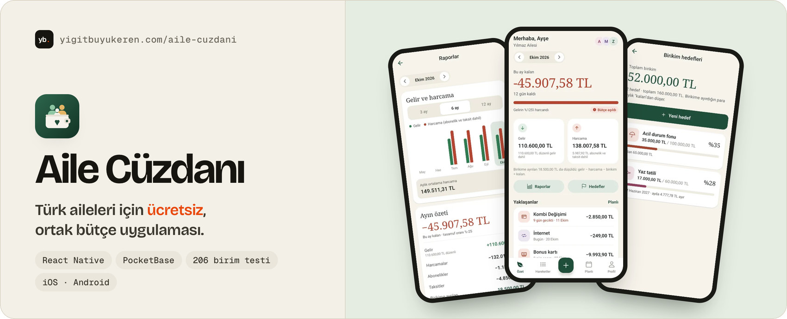
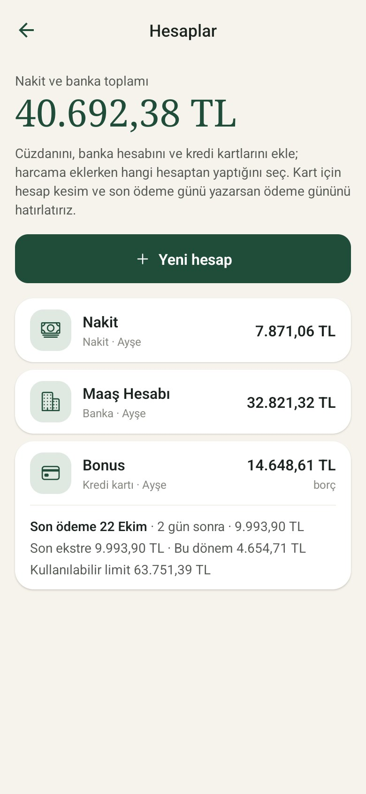
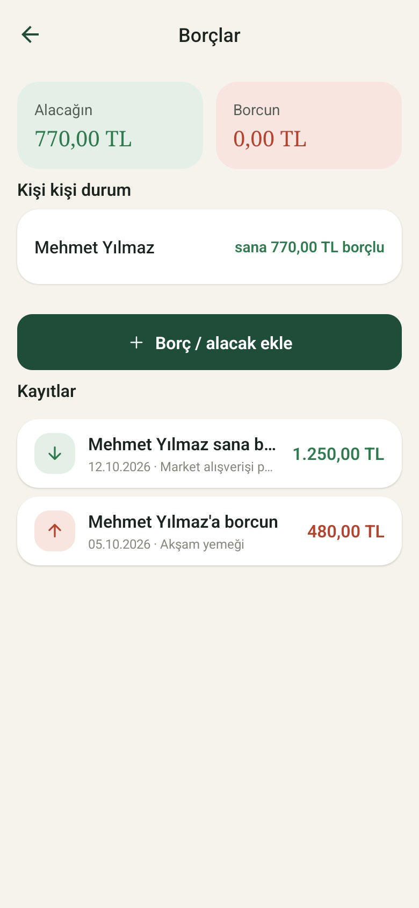

<a href="https://yigitbuyukeren.com/aile-cuzdani/">
  <picture>
    <source media="(prefers-color-scheme: dark)" srcset="banner-dark.jpg">
    
  </picture>
</a>

**[🌐 Proje sayfası](https://yigitbuyukeren.com/aile-cuzdani/)** &nbsp;·&nbsp; **[📸 Ekranlar](#-ekran-görüntüleri)** &nbsp;·&nbsp; **[🔒 Gizlilik](https://yigitbuyukeren.com/aile-cuzdani/gizlilik/)** &nbsp;·&nbsp; **[✉️ Destek](mailto:destek@yigitbuyukeren.com)**

🇹🇷 [Türkçe](#-türkçe) &nbsp;·&nbsp; 🇬🇧 [English](#-english)

<h2>🇹🇷 Türkçe</h2>

Türk aileleri için **ücretsiz, ortak bütçe** uygulaması. Maaşını bir kez ekle; gelir, gider,
taksit, abonelik ve birikim hedefleri tek ekranda, ailenin tüm üyeleriyle birlikte görünsün.

| 👨‍👩‍👧 **Ortak bütçe** | 💳 **Taksit ve abonelik** | 🏦 **Hesaplar ve borçlar** | 🎯 **Birikim ve raporlar** |
|:---:|:---:|:---:|:---:|
| Davet koduyla 5 kişiye kadar, çocuk rolü | İlerleme takvimden hesaplanır, gecikme uyarısı | Kredi kartı son ödeme günü, harcama bölme | Altın ve döviz hedefleri, PDF rapor |

> [!NOTE]
> **Durum:** Geliştirme aşamasında. Henüz App Store / Google Play'de yayında değil. Arka uç
> Türkiye'deki bir sunucuda (VPS) canlı çalışıyor; kaynak kod özel (private) tutuluyor,
> bu sayfa uygulamayı tanıtmak içindir. Ekran görüntülerindeki aile ve rakamlar **demo verisidir**.

### 📸 Ekran görüntüleri

<table>
  <tr>
    <td align="center"> <b>🏠 Özet</b> Ayın kalan parası, gelir ve harcama</td>
    <td align="center"> <b>📊 Raporlar</b> Aylık trend ve ayın özeti</td>
    <td align="center"> <b>🎯 Birikim hedefleri</b> Ortak hedefler, aylık ayırma önerisi</td>
  </tr>
  <tr>
    <td align="center"> <b>🧾 Hareketler</b> Güne göre gruplu, aranabilir liste</td>
    <td align="center"> <b>🗓️ Planlı ödemeler</b> Abonelik, taksit ve düzenli gelir</td>
    <td align="center"> <b>🏦 Hesaplar</b> Nakit, banka ve kredi kartı, kart için son ödeme günü</td>
  </tr>
  <tr>
    <td align="center"> <b>🤝 Borçlar</b> Aile içinde kim kime ne kadar borçlu</td>
    <td align="center" colspan="2"><b>🌐 Daha fazlası</b> <a href="https://yigitbuyukeren.com/aile-cuzdani/">yigitbuyukeren.com/aile-cuzdani</a>  Gizlilik politikası, kullanım şartları ve hesap silme sayfaları orada.</td>
  </tr>
</table>

### ✨ Neler var?

- 👨‍👩‍👧 **Ortak aile bütçesi:** davet koduyla 5 kişiye kadar; kim ne harcadı görünür, çocuk rolü ile sınırlı yetki
- 💼 **Düzenli gelir:** maaşı bir kez gir, her ay kendiliğinden eklensin
- 💳 **Taksit takibi:** ilerleme takvimden hesaplanır, Türkiye'deki taksit alışkanlığına göre
- 🔔 **Abonelik ve planlı ödemeler:** yaklaşan ödemeler ve gecikme uyarısı
- 🏦 **Hesaplar:** nakit, banka ve kredi kartı kayıtları; kart için hesap kesim ve son ödeme günü hatırlatması
- 🤝 **Borç ve alacak, harcama bölme, yorum:** kimin kime ne kadar borçlu olduğu ve harcamalara not
- 📷 **Fiş fotoğrafı:** isteğe bağlı, yalnızca bütçeyi görebilenlere açık
- 🪙 **Döviz ve altın:** döviz tutarlı harcama (elle kur), altın veya döviz cinsinden birikim hedefi
- 🎯 **Birikim hedefleri:** ortak hedefler ve hedef tarihe göre aylık ayırma önerisi
- 🚦 **Limitler:** kategori limitleri ve genel aylık limit; %80 ve %100'de bildirim
- 📊 **Raporlar:** 3 / 6 / 12 aylık gelir-harcama trendi, aylık rapor PDF olarak paylaşılır
- 📶 **Çevrimdışı:** son veriler önbellekte okunur, yeni işlemler bağlantı gelince gönderilir
- 📱 **Android widget ve uygulama kısayolları**
- 🔐 **Uygulama kilidi, "Tüm verilerimi indir" (PDF), hesap silme**
- 🌗 Türkçe arayüz, açık ve koyu tema

> [!TIP]
> **Tamamen ücretsiz:** reklam, premium, deneme sürümü ya da uygulama içi satın alma yok.

### 🛠️ Nasıl yapıldı?

| | |
|---|---|
| 📱 **İstemci** | React Native (Expo), TypeScript (strict) |
| 🗄️ **Sunucu** | PocketBase; erişim kuralları ve özel rotalar sunucuda uygulanır. Türkiye'de tek bir VPS, Caddy ile otomatik HTTPS, gece yedeği |
| ✅ **Test** | Vitest ile 206 birim testi, ayrıca gerçek bir PocketBase'e karşı HTTP seviyesinde 333 entegrasyon kontrolü |
| 🔔 **Bildirim** | Zamanlayıcı betik (Python), Expo push |

### 🏗️ Mimari

Kaynak kod özeldir; aşağısı tasarımın özetidir. Gizli anahtar, kullanıcı verisi veya sunucu yapılandırması içermez.

- **İstemci (React Native / Expo, strict TypeScript):** katmanlı yapı. Ekranlar sunucuya doğrudan konuşmaz; her alan (işlemler, abonelikler, taksitler, aile, özet, dışa aktarma, bildirimler) kendi servis modülünden geçer. Bağlam sağlayıcıları: tema → güvenli alan → kimlik → mod (bireysel/aile) → aile → gezinti. İstemcideki izin kontrolleri yalnızca kullanım kolaylığıdır.
- **Yetkilendirme:** e-posta + parola ile kimlik doğrulama, parola sıfırlama e-postayla gelen 6 haneli kodla. Asıl yetki **sunucudadır**: koleksiyon erişim kuralları, aile üyeliği ve rol (sahip, üye, çocuk) kontrolü, aile başına üye sınırı ve yoğun denemeye karşı hız sınırı sunucu tarafında uygulanır. İsteğe bağlı biyometrik uygulama kilidi.
- **Veritabanı:** PocketBase (SQLite). Şema yalnızca sürüm kontrollü, **yalnızca eklenen** migration dosyalarıyla tanımlanır (43 migration); uygulanmış bir migration değiştirilmez. Özel kurallar ve rotalar sunucu kancalarında durur.
- **Bildirimler:** istemci Expo bildirimleri; hatırlatmaları günlük, haftalık ve aylık zamanlayıcılar üreten ayrı bir Python betiği gönderir. Ödeme hatırlatmaları yalnızca kaydın sahibine, haftalık/aylık aile özetleri tüm üyelere gider.
- **Çevrimdışı:** son veriler önbellekten okunur; yeni işlemler kuyruğa alınır, bağlantı gelince gönderilir.
- **Test mimarisi (üç katman):** (1) Vitest ile 206 birim testi, tür denetimi ve lint ("0 hata, 0 uyarı" kapısı); (2) sunucu kancaları için kaynak düzeyinde kurallar testi; (3) geçici bir PocketBase örneğine karşı HTTP düzeyinde 333 entegrasyon kontrolü (yetki sınırları, rol kuralları, hız sınırı ve sunucu günlüğünde çalışma zamanı hatası taraması). Entegrasyon kontrolleri yalnızca yerel, atılabilir örneğe karşı çalışır; canlı veritabanına test verisi yazılmaz.

**Doğrulama durumu:** yukarıdaki sayılar bu tanıtım güncellenirken yerelde yeniden çalıştırıldı (206 birim testi geçti, tür denetimi ve lint temiz, 333/333 entegrasyon kontrolü geçti). Uygulama Android'de bir telefona kuruldu ve temel akışlar elle denendi; yeni eklenen bazı ekranlar (ör. fiş fotoğrafı, çevrimdışı kuyruk, widget) gerçek cihazda denenmedi. iOS için tam uygulama derlemesi henüz doğrulanmadı. Mağaza yayını yok.

<h2>🇬🇧 English</h2>

A **free, shared household budget app for Turkish families** (the name means "Family Wallet"). Add your salary once and see
income, expenses, instalments, subscriptions and savings goals on one screen, together with
your family.

| 👨‍👩‍👧 **Shared budget** | 💳 **Instalments** | 🏦 **Accounts and debts** | 🎯 **Goals and reports** |
|:---:|:---:|:---:|:---:|
| Up to 5 members, invite code, child role | Progress from the calendar, overdue alerts | Card due days, expense splitting | Gold and FX goals, PDF reports |

> [!NOTE]
> **Status:** In development. It is not on the App Store or Google Play yet. The backend
> runs live on a server (VPS) in Turkey; the source code is private and this page is a
> showcase. The family and numbers in the screenshots are **demo data**.

**Highlights:** shared family budget (up to 5 members, invite code, child role) · recurring income ·
instalment tracking built around how Turkish households actually pay · subscriptions and
planned payments · cash, bank and card accounts with statement and due-day reminders · debts and
expense splitting · optional receipt photos · foreign-currency entries and gold/FX savings goals ·
shared savings goals · category limits plus an overall monthly limit with alerts · 3/6/12-month
reports as PDF · offline cache with a queue for new entries · Android widget and app shortcuts ·
app lock · full data export · account deletion · Turkish UI with light and dark themes.

**Stack:** React Native (Expo) · TypeScript (strict) · PocketBase · Python notification
scheduler · 206 Vitest unit tests plus 333 HTTP-level integration checks against a real
PocketBase, running on a single VPS behind Caddy.

**Architecture in short:** layered React Native client (screens never talk to the backend directly; one service module per domain), PocketBase backend where authorization is enforced **on the server** (collection access rules, family membership and roles, per-family member limit, rate limiting), append-only versioned migrations (43), Expo push notifications driven by a separate scheduler, and a three-layer test setup: unit tests, hook-rule tests and HTTP-level integration checks against a throwaway local PocketBase. The source stays private; no keys, user data or server configuration are published here.

**Verification:** the test numbers were re-run locally for this update (206 unit tests pass, type check and lint clean, 333/333 integration checks). The app was installed on an Android phone and the core flows were tried by hand; some newer screens (receipt photos, offline queue, widget) have not been tried on a real device, and the full iOS build is not verified. It is not published in any store.

